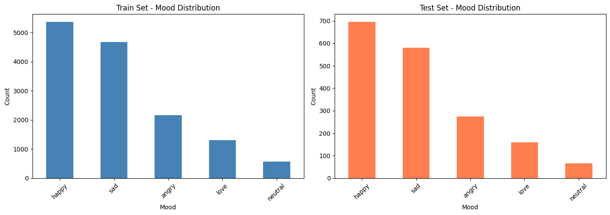

# 🎵 Moodify: Emotion-Based Music Recommender

Moodify detects your mood from a short piece of text and recommends Spotify songs that match it.
Type how you feel ("I'm feeling great today!"). A machine learning model classifies the emotion, and the app returns 5 tracks with album art and Spotify links.

## How It Works

```
User text ──► TF-IDF vectorizer ──► Logistic Regression ──► Mood ──► Spotify playlist ──► 5 songs
                                          │
                              confidence < 39%? ──► user picks the mood manually
```

1. **Text classification:** The input is vectorized with TF-IDF (unigrams + bigrams, 3,000 features). A Logistic Regression model then classifies it into one of five moods: `happy`, `sad`, `angry`, `love`, `neutral`.
2. **Confidence handling:** When the model's confidence is low, the app shows the score and asks the user to confirm the mood. Users can also correct a wrong prediction with the **"Wrong?"** button.
3. **Recommendation:** Each mood maps to a curated Spotify playlist. Tracks are fetched through the Spotify Web API (Spotipy) and 5 are sampled. Sampling is seeded by the input text, so the same text always returns the same songs.

## Dataset

[dair-ai/emotion](https://huggingface.co/datasets/dair-ai/emotion) from Hugging Face (English tweets labeled with emotions).

- The `fear` class was removed and `surprise` was relabeled as `neutral`.
- Final size: **14,063 training** and **1,776 test** samples.
- The classes are imbalanced, so the model is trained with `class_weight='balanced'`.



## Results

| Metric | Score |
|---|---|
| Test accuracy | **88.3%** |
| Macro F1 | 0.85 |
| Weighted F1 | 0.89 |

## Tech Stack

Python · scikit-learn · Pandas · NumPy · Hugging Face Datasets · Spotipy (Spotify Web API) · Streamlit · Matplotlib / Seaborn

## Project Structure

```
emotionmusicrecommendation/
├── data/                        # Cleaned train/test CSVs
├── models/
│   ├── mood_model.joblib        # Trained vectorizer + model
│   └── mood_distribution.png
├── notebooks/                   # Exploration
├── scripts/
│   ├── prepare_dataset.py       # Download & clean the dataset
│   ├── train_model.py           # Train & evaluate the classifier
│   └── test_sentence_length.py  # Confidence vs. input length check
└── src/
    ├── app.py                   # Streamlit web app
    └── spotify_client.py        # Spotify API client
```

## Getting Started

```bash
git clone https://github.com/senasagdc/emotionmusicrecommendation.git
cd emotionmusicrecommendation
python -m venv venv && source venv/bin/activate
pip install -r requirements.txt
```

Create an app on the [Spotify Developer Dashboard](https://developer.spotify.com/dashboard). Then copy `.env.example` to `.env` and fill in your credentials.

```bash
python scripts/prepare_dataset.py   # prepare data
python scripts/train_model.py       # train the model
streamlit run src/app.py            # launch the app
```

## Limitations & Future Work

- Works best with short inputs (1–2 sentences). Confidence drops on longer texts.
- TF-IDF does not capture context or negation well ("not happy"). A transformer-based model such as fine-tuned BERT could improve this.
- Recommendations come from a fixed playlist per mood. Personalizing them with the user's listening history is a natural next step.
